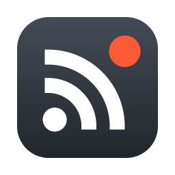
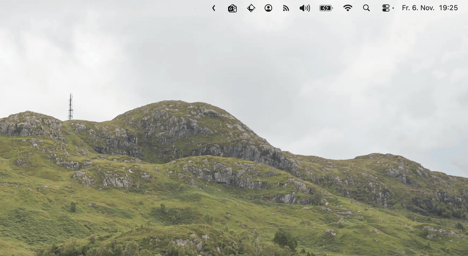

<p align="center">
  
</p>

<h1 align="center">RSS Notifications</h1>

<p align="center">
  Native macOS notifications for your RSS and Atom feeds.
</p>

<p align="center">
  <a href="https://github.com/Giebisch/rss-notifications/actions/workflows/ci.yml"></a>
  
  <a href="LICENSE"></a>
</p>

A small macOS menu bar app that watches your RSS and Atom feeds and posts a native notification for every new item. Click the notification and the article opens in your browser.

No feed reader, no unread counters, no account. Just a notification when something new is published.

<p align="center">
  
</p>

## Features

- **Native notifications** through Apple's UserNotifications framework, grouped per feed in Notification Center. Clicking one opens the item's link in your default browser.
- **Menu bar only**: no Dock icon and no windows.
- **RSS, Atom and JSON Feed** support via [gofeed](https://github.com/mmcdole/gofeed).
- **Manage feeds from the menu**: add, mute, rename and remove feeds, or open a feed's website.
- **Include and exclude filters** per feed: regular expressions on the item title decide which items you get notified about.
- **Adjustable refresh interval** from 1 minute to 1 hour. Changes apply immediately.
- **Pause notifications** for 5 minutes up to an hour, or until you resume them.
- **No notification flood**: items that already exist when you add a feed are skipped, and seen items are remembered across restarts.
- **Launch at login** via `SMAppService`, so the app shows up under Login Items like any other app.
- **Plain JSON config** you can back up or inspect.

## Requirements

- macOS 13 Ventura or later
- Go 1.25 or later
- Xcode Command Line Tools (`xcode-select --install`), needed for cgo

## Installation

```sh
go install github.com/Giebisch/rss-notifications@latest
rss-notifications install
```

The second command creates `RSS Notifications.app` in `~/Applications`, signs it ad hoc and starts it. If `rss-notifications` is not found, add `$(go env GOPATH)/bin` to your `PATH`.

To update, quit the app from the menu bar and run both commands again.

From a clone of this repository, `make install` does the same.

### Allow notifications

The app can only notify you once macOS allows it to. On first launch macOS asks for permission; if you missed or declined that prompt, or notifications don't show up:

1. Open **System Settings → Notifications → RSS Notifications**.
2. Turn on **Allow notifications**.
3. Choose **Banners** or **Alerts** as the style. With **None**, new items only appear in Notification Center.

### Uninstall

Turn off **Launch at Login** if you enabled it, quit the app, then remove the app, its settings and the binary:

```sh
rm -rf ~/Applications/"RSS Notifications.app" ~/Library/Application\ Support/"RSS Notifications"
rm "$(go env GOPATH)/bin/rss-notifications"
```

## Usage

Everything is in the menu behind the RSS icon in the menu bar:

```
Hacker News           ▸
The Go Blog           ▸
───────────────────────
Add Feed…
Check Now
Refresh Every         ▸
Pause Notifications   ▸
✓ Launch at Login
───────────────────────
Quit
```

**Add Feed…** asks for the feed URL, not the website URL. The app fetches the feed once to validate it and takes the name from the feed's title.

Each feed has a submenu with **Open Website**, **Mute**, **Include Filter…**, **Exclude Filter…**, **Rename…** and **Remove**.

**Mute** pauses notifications for a feed. Muted feeds are still checked, so unmuting doesn't send a notification for everything published in the meantime.

**Include Filter…** and **Exclude Filter…** take a [regular expression](https://pkg.go.dev/regexp/syntax) that is matched against each item's title. With an include filter you are only notified about matching items; with an exclude filter matching items are skipped. If both are set, a title has to match the include filter and must not match the exclude filter. Matching is case-sensitive; start the pattern with `(?i)` to ignore case. A checkmark shows which filters are active, and leaving the field empty turns a filter off. Filtered-out items still count as seen, so changing a filter later doesn't send a notification for older items.

| Filter | Pattern | Effect |
|---|---|---|
| Include | `Go\|Rust` | only items mentioning Go or Rust |
| Include | `(?i)release` | only releases, in any capitalisation |
| Exclude | `^Sponsored` | skips titles starting with "Sponsored" |

**Rename…** sets a custom name, which is also used as the notification title. Leave the field empty to go back to the feed's own title.

**Pause Notifications** silences all feeds for 5, 15, 30 or 45 minutes, an hour, or until you choose **Resume Notifications**. While paused, the menu bar icon is dimmed and the menu shows until when. Like a muted feed, feeds are still checked during a pause, so resuming doesn't send a notification for everything published in the meantime.

## Configuration

Feeds and settings are stored in

```
~/Library/Application Support/RSS Notifications/feeds.json
```

```json
{
  "interval_minutes": 10,
  "feeds": [
    {
      "url": "https://go.dev/blog/feed.atom",
      "title": "The Go Blog",
      "link": "https://go.dev/blog/",
      "seen": ["..."]
    }
  ]
}
```

Optional fields are `name` (set with **Rename…**), `muted`, `include` and `exclude` per feed, and `paused` / `paused_until` for a pause. The app rewrites this file after every check, so quit it before editing the file by hand.

## How it works

On every check the app fetches each feed and identifies its items by GUID, falling back to the link and then the title. Items whose ID is not in the feed's `seen` list trigger a notification. The list keeps the most recent 1,000 IDs, so an item that briefly disappears from a feed (for example because of a stale cached copy) does not trigger a second notification when it comes back.

The app is written in Go. About 180 lines of Objective-C, compiled through cgo, cover the parts that need Apple frameworks with no Go bindings:

| Component | Implementation |
|---|---|
| Menu bar icon and menu | [fyne.io/systray](https://github.com/fyne-io/systray) |
| Feed parsing | [gofeed](https://github.com/mmcdole/gofeed) |
| Notifications and click handling | `UNUserNotificationCenter` (`macos_darwin.m`) |
| Launch at login | `SMAppService` (`macos_darwin.m`) |
| Dialogs | `NSAlert` (`macos_darwin.m`) |

macOS only lets apps that run from a signed `.app` bundle use `UNUserNotificationCenter`. The plain binary therefore refuses to run on its own: `rss-notifications install` (or `make build` during development) wraps it in a bundle and signs it ad hoc. No Apple developer account is needed.

## Development

```sh
make test    # go vet and unit tests
make build   # build and sign build/RSS Notifications.app
make run     # build, quit any running instance, and launch
make install # install to ~/Applications
make clean
```

## License

[MIT](LICENSE)
